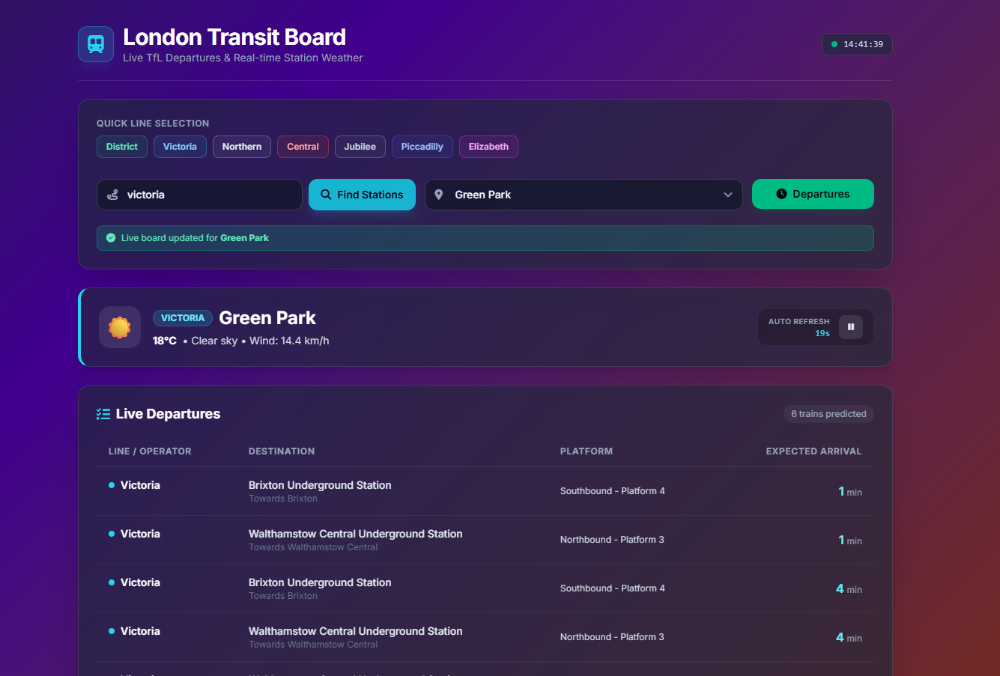
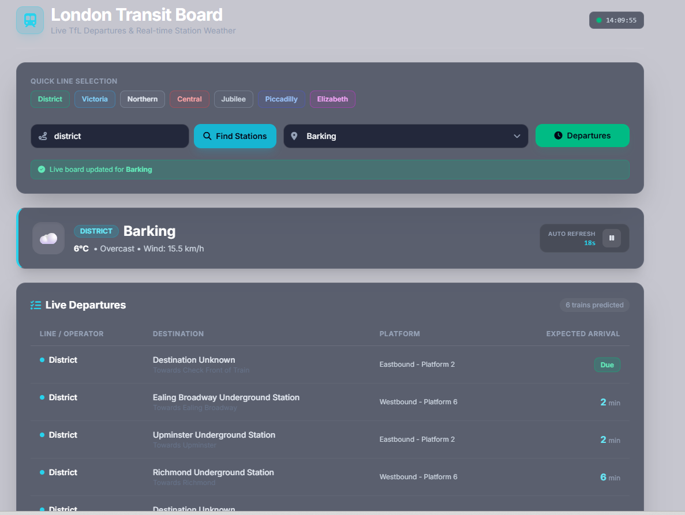

# London Transit Board

A real-time London Underground departure board featuring live station weather, dynamic background themes, and historical platform predictions.

## Features
* **Live TfL Departures:** Real-time arrival countdowns, destination information, and platform numbers across major London Underground lines (District, Victoria, Northern, Central, Jubilee, Piccadilly, and Elizabeth).
* **Real-Time Station Weather:** Pulls live temperature, wind speed, and conditions via the Open-Meteo API, dynamically changing the app's visual theme to match the weather.
* **Platform History Tracking:** Uses a local SQLite database to track and predict frequent departure platforms.
* **Auto-Refresh:** Built-in countdown timer that automatically keeps arrival boards up to date.

## Dynamic Weather Themes

| Clear Sky Theme | Overcast Theme |
| :---: | :---: |
|  |  |

## Built With
* **Backend:** Python, Flask, SQLite
* **Frontend:** HTML, Tailwind CSS, JavaScript
* **APIs:** Transport for London (TfL) Unified API, Open-Meteo Geocoding & Forecast APIs

## How to Run
1. Open your Google Colab notebook (`TfL_project_flask.ipynb`) from this repository.
2. Select **Runtime > Run all** in the Colab menu.
3. Click the generated `.colab.dev` preview URL in the final cell output to open the live departure board in your browser.
